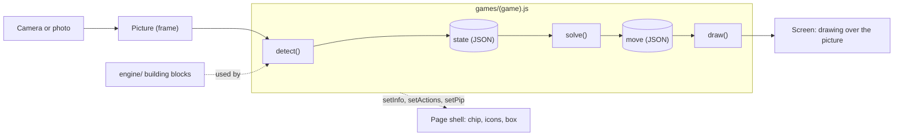
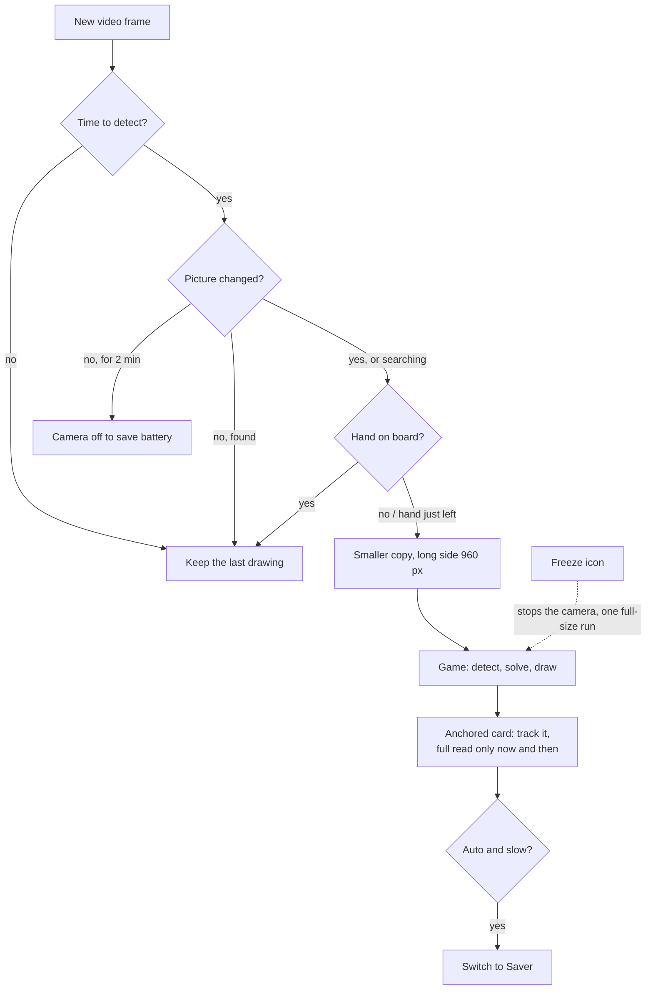
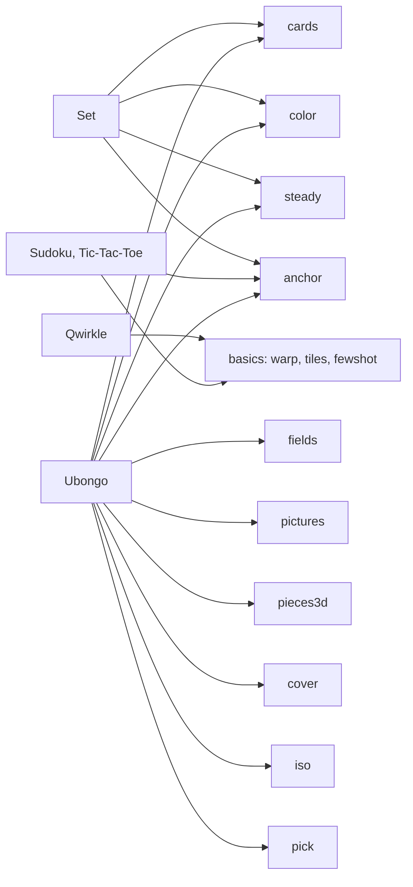
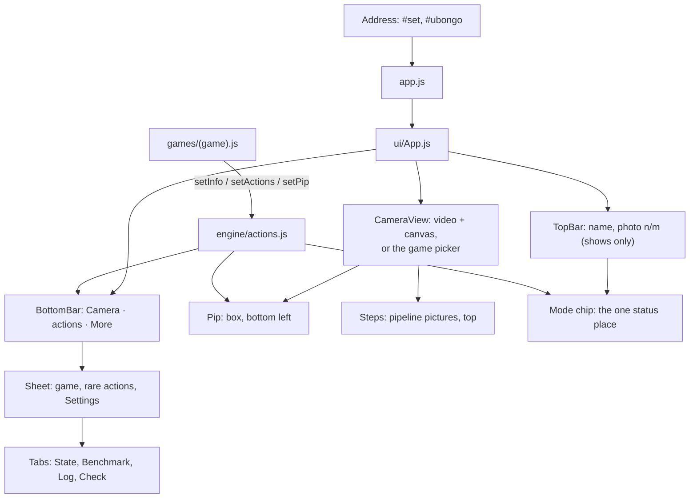
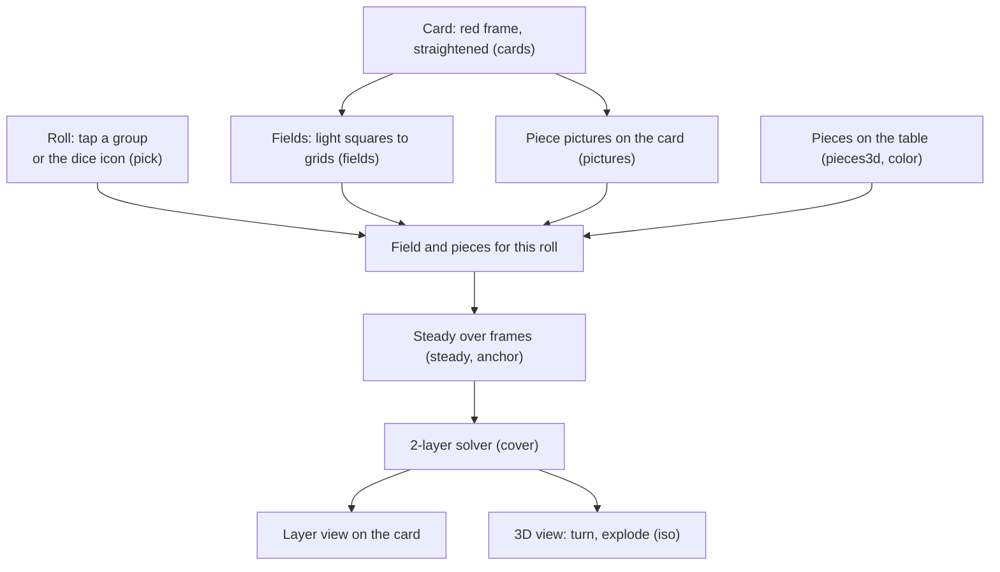
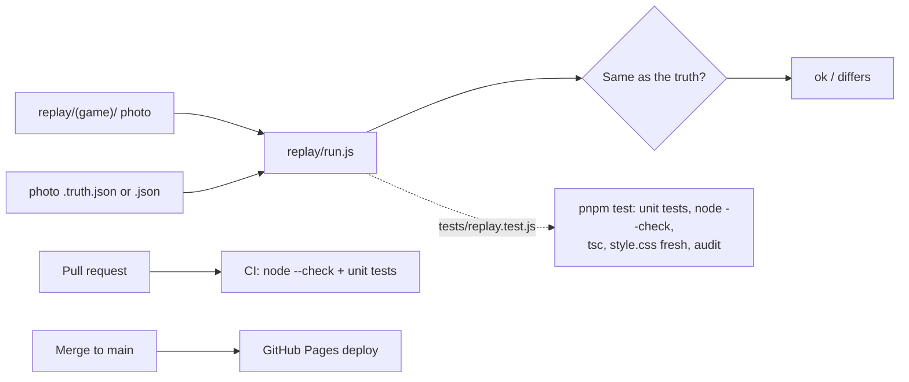
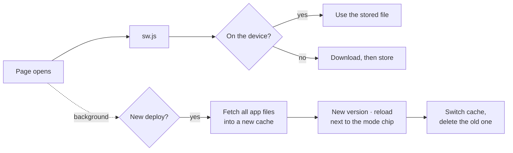

# Architecture

How board-vision is built, in pictures. One idea per diagram. The rules for working on the code are in
[`AGENTS.md`](../AGENTS.md); the building blocks in detail are in [`engine/README.md`](../engine/README.md).

Diagrams are [Mermaid](https://mermaid.js.org): GitHub draws them; `tests/mermaid.test.js` checks them.
Change the structure (a new file in `engine/`, `games/` or `ui/`, a new step in the loop)? Update this page too.

## Big picture

The phone camera (or a photo) gives a picture. The game file reads it with the engine's building blocks, turns it
into a plain JSON state, finds a move, and draws it over the picture. Everything runs in the browser; no server.

## Frame loop

On live video, `app.js` decides on each video frame whether `detect()` runs (rules in `engine/speed.js`).
Photos skip all of this and always run in full size. The checks, in order: the rate limit (Speed setting Auto, Saver
or Full) says whether it is time for `detect()`; a 64x48 grey thumbnail shows whether the picture changed; the hand
check sees a hand over the board. On Auto, a slow phone switches to Saver.
While the page is **searching** (nothing found since the camera start, Freeze off, a game or photo switch, Forget
corners or **Search again**), the picture and hand-gone checks are skipped: `detect()` runs on every frame the rate
limit allows, until it finds something (`detectNow` in `engine/speed.js`, `foundSomething` in `ui/mode-rules.js`).
Before #139 a restart ran `detect()` once only, often on a dark or blurry first camera frame, and then waited for a
hand to pass the board; that is why "search again" seemed not to work.

## Building blocks map

Which engine block each game uses (finished versions in `solutions/`). The basics (find board, straighten, cut
tiles, few-shot tiles) are in `engine/warp.js`, `engine/tiles.js` and `engine/fewshot.js`.

## Page shell

`app.js` runs the game and draws the page with Preact components from `ui/`. A game never draws buttons or text on
the picture: it hands them to the engine (`engine/actions.js`) and the shell shows them.

Mode chip (issue #139): top left in the top bar, always visible, one line with an icon that says what the app does right
now: what loads (`Loading hand model…`), `Looking for the board…`, `Found · <game's line>`, `Locked · …`,
`Frozen · tap ❄ for live`, `Hand over board · paused`, then for 2 s after the hand left `Move done · reading`
(issue #145), `Paused · tap to continue`. The rules are pure functions in `ui/mode-rules.js`
(`modeChip`), drawn by `ui/Chip.js`; the game's `setInfo` line is part of it. Loading labels and
`Reading the picture…` come from the one busy indicator (`engine/busy.js`, `ui.busy`), not from flags of their own. Two page buttons on the picture keep
their label: **Freeze picture** (❄, camera stops, picture stands still) and **Search again** (forgets a locked card
or board and reads the picture fresh). Locking happens by itself, so there is no lock button; the chip shows it.

First run (issue #152): the chip shows three hints, one at a time (Camera, More, Steps; the button it is about
gets a ring); a tap on the chip shows the next. Once seen they never come back (`localStorage`), unless "Show hints
again" in the More sheet. Rules in `ui/hint-rules.js`. With no picture, the empty screen is the game picker: a card per
game with a small picture (`ui/pictures/`) and what you need to play it (`ui/picker-rules.js`), above the Sample
photos and Start camera buttons. The Game select in the More sheet stays for quick switching.

Camera blocked (issue #153): when the camera does not start (permission denied, busy, none, not https), the chip says
the short line and `ui/CameraHelp.js` shows a panel at the bottom of the picture: 1–4 steps for this phone (iPhone
Safari, Chrome on iPhone, Android Chrome, laptop), a link to the Apple or Google help page, "Try again" and "Use
sample photos instead". The texts come from `cameraHelp` in `engine/camera.js`; `check.html` shows the same ones.

Steps view (issue #103): the "Steps" button (bottom bar, or the More sheet when the bar is full) turns it on. Then `engine/warp.js` and `engine/tiles.js`
record a picture per stage (camera, edges, found board or cards, straightened, tiles) in `engine/steps.js`, a game
may add its own with `engine.showStep`, and `ui/Steps.js` shows them as a strip at the top of the picture. Off, nothing
is recorded.

Knobs (issue #105): `engine/knobs.js` holds a few named numbers (the Canny thresholds, a game's own from
`config.knobs`) that the blocks read instead of constants (`engine.knob(name)`). The button "knobs" at the end of the
Steps strip opens sliders; a move sets the value and `app.js` runs the pipeline again (live: on the next frame).
Values live in memory only; "Reset" or another game brings back the defaults.

Hands visible (issue #133): the tile "Show hands" in the More sheet (or `&hands=show`) turns on `ui/HandLayer.js`, a
see-through canvas over the live video. On every hand check `engine/hands.js` hands over the 21 points of each hand
(`onHands`) and the layer draws them as bones (`HAND_BONES`). The hand status ("Hand over board · paused") is in
the mode chip only (`ui/mode-rules.js`, issue #139). Off, nothing is drawn; the hand check itself runs as before. While the camera runs, the page asks for a
screen wake lock.

### Address and demo flags

`engine/route.js` reads the address: `#<game>` picks the game, `&solution` the finished version. The demo launcher
`workshop/index.html` (issue #133) adds small flags, unit tested in `tests/route.test.js`:

| Flag | What it does |
|---|---|
| `&card=A24` | Ubongo: this card from `CARDS` counts as confirmed (no "Card looks right ✓"), not saved unless you edit its pieces |
| `&replay` | Starts the game's replay photos right away (the backup) |
| `&camera` | Starts the camera right away (pre-flight already asked for the permission) |
| `&hands=show` | Hand skeleton and hand chip on |
| `&steps=rules` | Opens the Steps view with this stage large (`rules` Set, `scores` Sudoku, `fingerprint` Ubongo; the slides' ▶ buttons) |

The launcher's buttons open this site's app when it has `solutions/`, else the owner's demo site (`DEMO` in
`workshop/launcher.js`, equal to `export/config.js`). Its pre-flight shares the checks of `check.html`
(`engine/checks.js`) and warms the cache of the site it runs on only. Both pages download the four big files
(OpenCV.js, MediaPipe WASM, both models) side by side in one list (`ui/download-rows.js`, issue #162): per file a thin
bar and `3.2 / 10.1 MB · ~6 s left`, a total line on top, `from device ✓` when the device cache has it already.

## Ubongo flow

The fullest example: almost every building block in one game. The solver is the open task in `games/ubongo.js`;
`solutions/ubongo.js` has it.

## Tests and replay

Tests run in Node, without a browser or camera. Replay photos with a known answer check the games end to end.

## Device cache (offline)

`sw.js` (a service worker at the site root, issue #136) keeps the big files on the device, so the second start is
fast and works in airplane mode. `engine/cache-rules.js` decides per URL; `engine/offline.js` starts it from `app.js`
and `check.html`. It is **off on localhost and on `*.ts.net`** (`tailscale serve`, the phone test without deploy), so live reload
always shows the newest game file; `?sw=1` in the address turns it on there (`?sw=0` turns it off).

- **Libraries and models** (jsDelivr URLs with an exact version, MediaPipe model files): fetched once, then always
  from the device (cache `board-vision-libs`).
- **App files** (HTML, JS, CSS): **network first**, the device copy only when offline or the network takes more
  than 4 s (cache `board-vision-app-<stamp>`; the stamp is the start page's `Last-Modified`, new on every Pages
  deploy). Cache-first mixed old and new modules after a deploy ("Importing a module script failed" on iPhone).
- **Photos** (`.jpg`, `.png`, …): kept when first opened, refreshed in the background (`board-vision-photos`).
- **Settings** stay in `localStorage`. "Clear cache" (More sheet, `check.html`) deletes the caches, not the settings.

The note waits for a tap, so old and new app files never mix in one page. During an update, a file the new deploy
no longer has (renamed or deleted, the server answers 404) is left out instead of stopping the update. One gap: a
file that is not stored yet (for example a game opened for the first time) comes from the network, so after a new
deploy it is the new version next to the stored old files until the tap. `check.html` loads every library and
model once, stores them, asks for persistent storage (`navigator.storage.persist()`) and lists what is stored.
iPhone Safari may clear the data of a site that was not opened for some weeks; adding the page to the home screen
helps (the app is installable, see below). Known limit: after a version bump of OpenCV.js or MediaPipe the old library files stay in
`board-vision-libs` until "Clear cache".

## Files map

| Folder / file | What lives there |
| --- | --- |
| `index.html` | The page; its import map pins the CDN versions of Preact, htm, OpenCV.js, MediaPipe |
| `app.js` | Reads the game from the address, runs the frame loop, draws the page |
| `sw.js` | Service worker: keeps libraries, models, app files and photos on the device (see Device cache) |
| `manifest.webmanifest`, `icons/` | Installable app (issue #151): name, full screen, icons; relative paths, so it works under any site folder. Every page links it, plus the iPhone tags. The launcher and `check.html` show one install line (`installHint` in `engine/device.js`) |
| `ui/` | Preact components of the page shell (top bar, picture, bottom bar, hand layer, sheet, icons), `ui/tokens.css` = the design tokens, `ui/hint-rules.js` first-run hints, `ui/CameraHelp.js` the camera-blocked help, `ui/picker-rules.js` + `ui/pictures/` the game picker (issue #152), `ui/download-rows.js` = the pre-flight download list of the launcher and `check.html` (plain DOM, issue #162) |
| `engine/` | Shared code, given to games as `engine`; `engine/index.js` is the whole public API |
| `games/` | One file per game (`detect`, `solve`, `draw`); `games/list.js` lists them |
| `solutions/` | Finished versions of the starter games, for the owner (`#game&solution`) |
| `replay/` | Photos with their expected state, and `replay/run.js` to check them without a browser |
| `tests/` | Unit tests, run by `node tests/run.js` |
| `scripts/` | Dev tools: local server and port rules, learning-track checker (`learn.js`, `pnpm learn tictactoe|set`), Ubongo reference maker, app icons (`icons.js`), the "All pages" list (`pages-index.js`) |
| `workshop/` | Demo launcher (`index.html`, `launcher.js`, with the plan B list), QR codes for the slides and the launcher (`qr/*.svg`), facilitator guide, slides, talk notes, checklist, announcement; `learn/`: guided lessons per track (Tic-Tac-Toe, Set) with pictures |
| `docs/` | This page, the dependency rules (`DEPENDENCIES.md`) |
| `check.html`, `tiles.html`, `warp.html`, `print.html` | Device check, debug pages, A4 print sheets |
| `links.html`, `links.js`, `pages.json` | "All pages" (issues #172, #179): part 1 "On this site" has every `*.html` page and every app address (each game with every flag from `FLAGS` in `engine/route.js`, finished versions, the known Ubongo cards, the launcher demos), each with its exact path; part 2 "On GitHub" (collapsed, at the bottom) has the Markdown docs, lessons and game files on github.com. A test fails when a path is missing from part 1. Opens from "All pages ›" at the top of the More sheet (the only entry point in the app). `pages.json` is built by `scripts/pages-index.js` from the files (each page's `<title>` and `<meta name="description">`, the cards in `games/ubongo.js`); a test fails when it is stale. Games and demos come from `games/list.js` and the launcher's `DEMOS` |

### engine/

| File | What it does |
| --- | --- |
| `engine/index.js` | The public API: everything a game gets as `engine` |
| `engine/types.js` | Types of the game contract (JSDoc only, no code) |
| `engine/libs.js` | Loads OpenCV.js and MediaPipe lazily, only when a game needs them |
| `engine/busy.js` | The busy indicator's state: what loads or works now, download progress, latest tap wins (issue #134). Shown by `ui/Busy.js` (app; a failed job's error goes to the mode chip, issue #171) and `ui/busy-plain.js` (plain pages) |
| `engine/progress.js` | Download progress in words: speed over the last 2 s, time left, `3.2 / 10.1 MB · ~6 s left` (issue #162); used by the busy pill and the pre-flight list |
| `engine/camera.js` | Opens the camera, loads photos; `cameraHelp` = what to do when the camera is blocked (app and device check) |
| `engine/warp.js` | Finds a board or cards, straightens them |
| `engine/corners.js` | Tap the four corners by hand |
| `engine/geometry.js` | Points and quads: a board point to a picture point |
| `engine/tiles.js` | Cuts a board into tiles, colours of a tile |
| `engine/fewshot.js` | Few-shot tiles: embeddings, references, nearest match |
| `engine/hands.js` | Hand check: pause while a hand is over the board |
| `engine/actions.js` | What a game shows around the picture: chip, icons, picture-in-picture |
| `engine/speed.js` | Speed setting and the rules of the live loop |
| `engine/bench.js` | Benchmark numbers and targets |
| `engine/debug.js` | Console messages on screen (Log tab) |
| `engine/device.js` | What the browser can do (WebGPU, camera) |
| `engine/checks.js` | The device checks of `check.html` and the launcher's pre-flight (camera, models, wake lock) |
| `engine/route.js` | Game and solution mode from the address |
| `engine/cache-rules.js` | Device cache: which URL goes into which cache (used by `sw.js`) |
| `engine/offline.js` | Device cache, page side: starts `sw.js`, update note, Clear cache, what is stored |
| `engine/replay.js` | Runs a game over replay photos and compares with the truth |
| `engine/learn.js` | Learning-track checker rules, one result per TODO: `pnpm learn` and "Check my game" in the More sheet (`ui/CheckPanel.js`) share them |
| `engine/cards.js` | Block "cards": many cards, straight and lying; a framed card |
| `engine/fields.js` | Block "fields": light squares to grids |
| `engine/color.js` | Block "color": white balance from paper, hue |
| `engine/pictures.js` | Block "pictures": small printed icons to names |
| `engine/pieces3d.js` | Block "pieces3d": 3D pieces on a table to names |
| `engine/iso.js` | Block "iso": draw cubes in 3D |
| `engine/cover.js` | Block "cover": fill a shape with pieces (solver) |
| `engine/steady.js` | Block "steady": labels that do not flicker |
| `engine/anchor.js` | Block "anchor": a card that stays put on live video |
| `engine/pick.js` | Block "pick": a tap to the area or button under it |
| `engine/details.js` | Clean overlay: labels only in Steps, a tap shows one name (callout) |
| `engine/steps.js` | Steps view: a picture per pipeline stage of the last frame (`engine.showStep`) |
| `engine/knobs.js` | Knobs: named numbers with a slider in the Steps view (`engine.knob`) |

### games/

| File | What it does |
| --- | --- |
| `games/_blank.js` | Empty template; the contract explained in comments |
| `games/list.js` | The games in the game picker |
| `games/set.js` | Set starter, learning track 2: finds and straightens the cards; 7 TODOs (features, sets, steady) |
| `games/qwirkle.js` | Qwirkle starter: tiles, their colour and shape |
| `games/sudoku.js` | Sudoku on the printed sheet |
| `games/tictactoe.js` | Tic-Tac-Toe on the printed sheet |
| `games/ubongo.js` | Ubongo starter: reads everything, the solver is open |
| `games/ubongo.refs.json` | Reference pictures for the Ubongo piece pictures |
