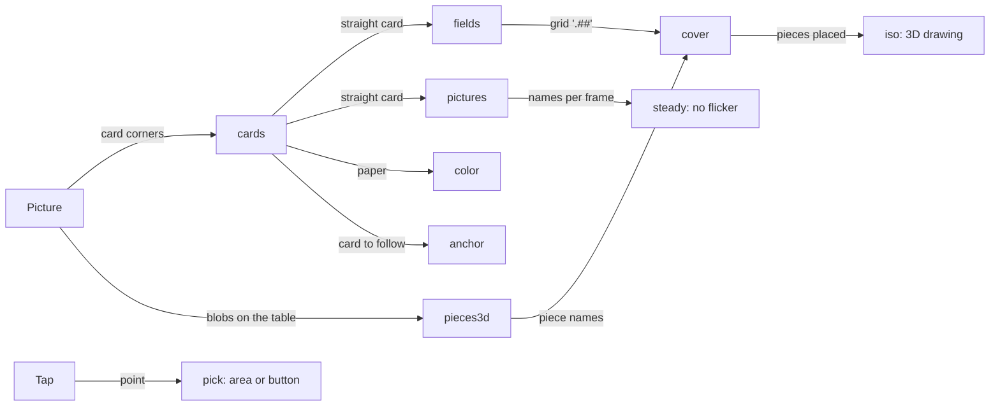

# Engine building blocks

Ready-made parts to build your own game from. Each block is one small file in `engine/`, plain JavaScript, plain
JSON in and out. Your game gets all of them as its `engine` argument (`engine/index.js` is the full list):

```js
export async function detect(frame, engine) {
  const quads = engine.cardSized(await engine.findCards(frame));
  ...
}
```

The pure blocks (no OpenCV, no camera) also work in `draw()` and in tests: import the file directly, e.g.
`import { coverGrid } from '../engine/cover.js';`.

Basics (older, see the main [README](../README.md)): `findBoard`, `findCards`, `straighten`, `cutTiles`,
`dominantColor`, `colorName`, `classify` (few-shot tiles), `watchHand`, `boardPoint`,
`setActions` / `setInfo` / `setPip` (icon buttons, the line in the mode chip and picture-in-picture box, `engine/actions.js`).

| Block | File | What it does | Used by |
| --- | --- | --- | --- |
| [cards](#cards) | `engine/cards.js` | Many cards: keep card-sized shapes, cut touching cards apart, straighten lying; one card by its coloured frame | Set, Ubongo |
| [fields](#fields) | `engine/fields.js` | Light squares printed on a card or board → grids (`'.##'`) | Ubongo |
| [color](#color) | `engine/color.js` | White balance from the paper of a card, paper checks, hue | Set, Ubongo |
| [pictures](#pictures) | `engine/pictures.js` | Small printed pictures → cut-outs → names by a few reference cut-outs | Ubongo |
| [pieces3d](#pieces3d) | `engine/pieces3d.js` | Coloured 3D pieces on the table → names from a catalogue | Ubongo |
| [iso](#iso) | `engine/iso.js` | Draw cubes in 3D on the canvas: turn, explode | Ubongo |
| [cover](#cover) | `engine/cover.js` | Solver: fill a shape with pieces of cubes, 1 to n layers | Ubongo |
| [steady](#steady) | `engine/steady.js` | Labels that do not flicker on live video (votes over frames) | Set, Ubongo |
| [anchor](#anchor) | `engine/anchor.js` | A confirmed card or sheet stays put on live video: tracked, smoothed, held when lost | Ubongo, Set, Sudoku, Tic-Tac-Toe |
| [pick](#pick) | `engine/pick.js` | A tap on the picture → the area of the card or the button under it | Ubongo |
| [details](#details) | `engine/details.js` | Clean overlay: labels only in Steps, a tap shows one name in a callout | Qwirkle, Set |

Have a look at `games/ubongo.js` (uses almost all blocks) and `solutions/set.js` (cards, color, steady).
To see what a block does before you code with it: [mini tasks](../workshop/tasks.md) (2–5 minutes each, no code).

What goes in and what comes out of each block (which game uses which: [docs/ARCHITECTURE.md](../docs/ARCHITECTURE.md)):



## How recognition works

Nothing here is trained. Every game uses one of three techniques; explained with Set, Sudoku and Ubongo as worked
examples on the [slides](../workshop/slides.html) (slides 14–21, part B) and in the
[talk notes](../workshop/building-blocks.md):

- **Rules on pixels** (classic computer vision): measure, then if / else. Set (hue, symbol count, ink share, box
  fill), Tic-Tac-Toe (ink per cell), board finding (dark frame), Ubongo's red frame and light squares (`fields`).
- **Compare with references** (few-shot): `pixelEmbedding` + `matchTile` with references drawn by code (Sudoku,
  Qwirkle), photo cut-outs (`pictures`, Ubongo), or `classify` with the MediaPipe embedder (offered, `tiles.html`).
  A new thing = a new reference.
- **Geometry and memory** (Ubongo): the card's fingerprint (shapes of its fields) → a card this browser confirmed;
  table pieces → a catalogue of cube shapes (`pieces3d`); the solver is plain search (`cover`).

## cards

```js
const quads = engine.cardSized(await engine.findCards(frame));       // cards that touch are cut apart
const image = await engine.straightLying(frame, quads[0], 300, 200); // always lying: 300 wide, 200 high
const card = engine.findColorFrame(frame, 'red');                    // a card with a red frame: corners or null
```

Also `turnQuarter(image)`. Limits: cards must not overlap; `cardSized` needs most found shapes to be cards (it
takes their middle size); a lying card may come out upside down.

## fields

```js
const card = await engine.straighten(frame, corners);
const [top, bottom] = engine.findFields(card, 0.128, 2);  // 0.128: a square is 12.8 % of the card width (Ubongo)
// top.grid = ['.#..', '####', '##..'], top.area = { left, top, width, height } (shares 0–1 of the card)
```

Also `readGrid(card, share, fromRow, toRow)` for one part of the card. Limits: light squares without much colour on
a dark or coloured card; all squares one size, given as `share` (the lines between squares only confirm the count,
faint lines are fine); 2 to 10 squares per side.

## color

```js
const paper = engine.paperColor(cardImage);       // [r, g, b] of the white paper, or null (not a paper card)
const gains = engine.paperGains(cardImage);       // multiply pixels by these: the paper becomes grey
const h = engine.hue(r, g, b);                    // 0–360: red 0, green 120, blue 240
```

Also `paperTint(a, b)` (is this the same white?) and `usualPaper(papers)` (the middle paper of many cards).
Colour words: `engine.colorName({ r, g, b })`. Limits: needs a light card in the picture; very coloured light still
shifts colours.

## pictures

```js
const icons = engine.findPatches(card, { colorOf: engine.colorName });   // [{ color, box: [x0, y0, x1, y1] }]
const cut = engine.cutOut(card, icons[0].box, (r, g, b) => engine.colorName({ r, g, b }) === icons[0].color);
const best = engine.rankByRefs(cut, ['red1', 'red2'], refs)[0];          // { name, score 0–1 }
```

References: `{ piece: 'red2', ...engine.toRef(cut) }` per example, saved as `{ "refs": [...] }` in a JSON file next to
your game, read with `engine.loadRefs(new URL('./mygame.refs.json', import.meta.url))`. Also `groupNear(patches, n)`
(n groups of pictures that lie close together) and `bestCombination(reads, ok)` (best names that keep a rule, e.g.
no piece twice). Limits: one strong colour per picture, about 2–9 % of the card width, apart from each other;
turned or mirrored pictures do not match.

## pieces3d

```js
const catalogue = engine.pieceCatalogue({ red2: { color: 'red', cubes: [[0, 0, 0], [0, 0, 1]] } }); // once
const blobs = engine.findBlobs(frame, cardCorners, cellPixels, { colors: new Set(['red']), colorOf: engine.colorName });
const named = engine.nameBlobs(blobs, catalogue, engine.tableCamera(frame, cellPixels)); // [{ name: 'red2' | '?', score }]
```

Cubes are `[layer, row, col]`. `cellPixels` = one cube's side in the picture. Also `splitBlob` (two pieces that
touch). Limits: one strong colour per piece, pieces outside the card and not at the picture's edge; pieces of one
colour that look alike from above are easily mixed up (try the others: `firstWorking` in cover).

## iso

```js
const cubes = engine.placementCubes(move.placements, (piece) => '#ef4444');  // or [{ at: [l, r, c], color }]
const offsets = engine.explodeOffsets(cubes, 1.2);                           // pieces apart, or []
engine.drawPolygons(ctx, engine.isoPolygons(cubes, { angle, offsets }), engine.fitView(cubes, offsets, box));
```

Limits: cubes on a grid only; a few hundred cubes per picture.

## cover

```js
const pieces = [{ name: 'L', cubes: [[0, 0, 0], [0, 0, 1], [0, 1, 0]] }, { name: 'I', cubes: [[0, 0, 0], [0, 0, 1]] }];
const placements = engine.coverGrid(['##', '#.', '##'], pieces, 1);   // layers: 1, 2, …
// → [{ piece: 'L', cells: [[layer, row, col], …] }, …] or null
```

Pieces turn every way a solid can (24), never mirrored. Also `orientations(cubes)` and
`firstWorking(options, works)` (try other readings until one works). Limits: plain backtracking, fine for a few
pieces (Ubongo: 3–4, under 2 ms).

## steady

```js
const votes = engine.createVotes({ features: ['color', 'number'] });   // once, outside detect
export function steady(state) { return { ...state, cards: votes.update(state.cards) }; }
const hold = engine.holdSteady(3);  // one value: a new value counts after 3 frames in a row: shown = hold(seen)
```

`steady(state)` in your game is called by the page on live video only. Limits: cards are followed by position, so
two cards that swap places swap their votes.

## anchor

```js
import { createAnchor } from '../engine/anchor.js';
const anchor = createAnchor();                           // once, outside detect
export async function detect(frame, engine) {
  return anchor.run(frame, () => readEverything(frame, engine), {
    key: (state) => state.card,     // another key seen for ~1 s = another card: it takes over
    sure: (state) => state.known,   // lock only once the card is confirmed (default: as soon as corners are found)
  });
}
```

Live video only (photos always read fully). Once locked, your reading function runs only every 10 frames (or
0.5 s) or when tracking gets poor; in between, a few strong points inside the card are followed with OpenCV.js
optical flow (about 4 ms per frame), and the kept state moves along (every `{x, y}` in it). The corners shown are
averaged, so small shakes do not move the drawing. A lost card is held for 1 s, then fades out. `reread: true`
keeps reading the content (Tic-Tac-Toe marks), only the position stays steady. Many cards: `cornersOf: cardsBox`
(Set). The mode chip says `Locked · …` while a card is locked; **Search again** reads it fresh. Limits: the card needs some print
to follow; boxes as `[x0, y0, x1, y1]` arrays do not move along; a very fast swing loses it until the next full read.

## pick

```js
canvas.addEventListener('pointerdown', (event) => {
  const p = engine.canvasPoint(event, canvas);                    // the tap in picture pixels
  const k = engine.areaAt(state.corners, areas, p);               // index of the area (on the card) under it, or -1
});
```

Also `areaCorners(corners, area)` (draw an area of the card on the picture) and `inBox(p, button)`. Limits: areas
are rectangles on the straight card; the first hit wins when they overlap.

## details

The clean overlay (issue #163): by default `draw()` shows only outlines of what was found and the suggested move.
Labels and grid lines show in the Steps view; outside it, a tap on a tile or card shows its name in a small callout.
Import `engine/details.js` directly in `draw()` (as Qwirkle and Set do):

```js
if (detailsOn()) drawLabels(ctx, tiles);                    // every label only while Steps is open
const tap = tapPoint();                                     // the last tap on the picture, or null
const t = tap && tiles.find((t) => pointInPolygon(tap, t.corners));
if (t) drawCallout(ctx, tap, `${t.color} ${t.shape}`);     // one name at the tapped tile
```

The page draws again after a tap only when the last `draw()` called `tapPoint()`. A new photo, the camera or a game
switch forgets the tap. Limits: one callout at a time; a game with its own tap handler (Set solution, Ubongo) keeps it.

## steps

```js
engine.showStep('ink', inkImage);                                      // your own picture in the Steps view
engine.showStep('cells', board, { boxes: [{ x: 0, y: 0, width: 60, height: 60 }] }); // with boxes drawn on it
engine.showStep('shapes', frame, { quads: [corners] });                 // with outlines (first one green)
engine.showStep('rules', card, { lines: ['hue 352° → red'] });          // with text under the large picture
```

The Steps view (tile "Steps" in the ⋯ sheet) shows a small picture per stage of the last frame, live. The basics
record their own: `camera`, `edges` and `bright patches` (findBoard / findCards), `found board` or `found cards`,
`straightened` (straighten), `tiles` (cutTiles, cropTiles). The same name again replaces the picture (the last one of
a frame wins); a stage a frame skips keeps its last picture (an anchored card is often only tracked on live video).
`lines` are short text shown under the picture when it is large: what was measured and which rule or reference
decided (Set: `rules`, Ubongo: `fingerprint`). `#<game>&steps=<stage>` opens the view with that stage large.
Limits: only while the view is on (otherwise `showStep` does nothing); one picture per name.

The last stage is `scores` when the game names tiles by few-shot (`classify`, or `matchTile` with numbers of your own,
e.g. `pixelEmbedding`): one entry per tile of the last frame with its 3 best names and their cosine similarity
(1 = looks the same), shown as bars after a tap on the tile. `classify` also keeps the tile picture, the backend
(Image Embedder on the GPU = WebGPU / WebGL, or CPU = WASM) and the ms for that tile. Only for looking: the
name itself is still decided by `matchTile` (k nearest references vote), so it can differ from the top bar.

## knobs

```js
const low = engine.knob('edgeLow');                                     // the current value of a knob
export const config = { title: 'My game',                               // a knob of your own
  knobs: [{ name: 'inkLimit', label: 'Ink limit', value: 0.2, min: 0, max: 1, step: 0.01 }] };
```

Knobs (issue #105) are numbers you turn with sliders in the Steps view (button "Knobs" at the bottom of the view)
and watch a stage change live. The engine's own: `edgeLow` / `edgeHigh` (the two Canny thresholds of the `edges`
stage in findBoard / findCards: lower = more edges). A game adds its own in `config.knobs` and reads them with
`engine.knob(name)`. Limits: values live in memory only (a reload or "Reset" brings the defaults back); an unknown
name throws; a game knob may not reuse an engine knob's name.
