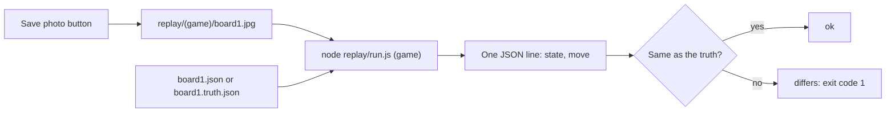

# replay

Photos of real boards for testing without a camera. One folder per game, e.g. `replay/qwirkle/`.
Take them with the **Save photo** button on the page (phone or laptop), then copy them into the folder.

- Photos: `.jpg` or `.png`.
- Expected state (optional): a `.json` file with the same name next to the photo (`board1.jpg` → `board1.json`).
- `index.json`: the list of photos, so the page's **Sample photos** button can find them.
- `samples.json` (optional): photos from sub-folders shown first under **Sample photos** (e.g. `owner/deck-b-wide.jpg`).
  Set lists only real photos that `solutions/set.js` reads right (issue #144, checked by `tests/replay.test.js`).



Where this sits in the whole project: [docs/ARCHITECTURE.md](../docs/ARCHITECTURE.md).

Run all photos of a game, without a browser:

```
pnpm install                 # once, installs the image decoders
node replay/run.js qwirkle   # one JSON line per photo
```

Each line: `{"photo": "board1.jpg", "state": {...}, "move": ..., "check": "ok"}`. `check` is `ok`, `differs`
or `no expected state`. The command fails (exit code 1) if any photo differs. It also updates `index.json`.

More options:

```
node replay/run.js set --solution              # solutions/set.js instead of games/set.js
node replay/run.js set/test-images --solution  # a sub-folder (here: six real Set photos)
node replay/run.js set/stress --solution       # harder copies: darker warm light, turned 15°, a little blur
```

`replay/set/stress/` is made by `node replay/make-stress.js` from the other Set photos, with the same truth.

Card games can use a `<photo>.truth.json` instead: just the list of cards with their features, in reading
order (rows top to bottom, left to right), e.g. `[{"color":"red","number":1,"shape":"oval","fill":"solid"}]`.
Each line then has a `score`: cards found, features read right, and the cards with a mistake.
A `.webp` photo must be turned into `.jpg` first (the script reads only `.jpg` and `.png`).

Grid games (Sudoku, Tic-Tac-Toe) use a `<photo>.truth.json` that is just the grid, a list of rows, e.g.
`[["X","","O"],["","X",""],["","",""]]`. It is compared with the state's grid; `wrong` lists the cells that differ.

Other games can use a `<photo>.truth.json` object instead, e.g. Ubongo: `{"field": "top", "grid": [...], "pieces": [...]}`.
Only those keys of the state are compared; `wrong` lists the keys that differ. If `replay/<game>/check.js` exists,
its `checkMove(state, move)` checks the move too (`"solution": "valid"`), and its `compareTruth(state, truth)`
replaces the comparison above (Qwirkle: board tiles plus the hand). `replay/ubongo/flat/` holds old drawn
pictures (see the note there).

`tests/replay.test.js` runs every `solutions/*.js` and the Ubongo demo over its replay folder and expects `ok`.

Note: the browser turns phone photos upright (EXIF rotation); this script does not. Photos saved with the
**Save photo** button have no rotation, so both see the same picture.

`replay/test/` holds drawn test pictures (not real photos) for the board and card search; `tests/warp.test.js`
checks them. `node replay/make-test-images.js` draws them again.
