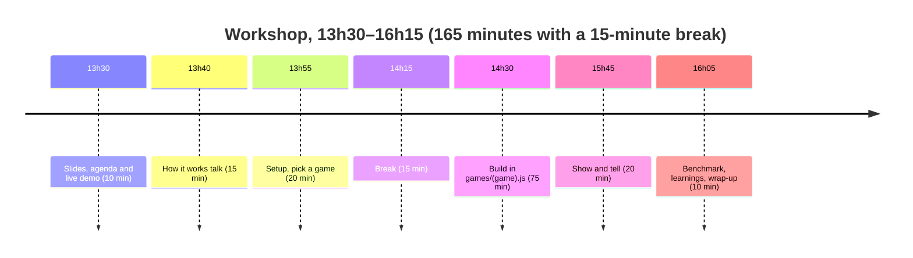

# Facilitator guide (for whoever runs the workshop; participants may read it too)

2.5 hours, pairs or solo, everyone uses their own AI tool (Claude Code, Codex, …).
Other material in this folder: [intro slides](slides.html), [building blocks talk](building-blocks.md), [game checklist](game-checklist.md),
[announcement](announcement.md). Setup steps for participants: [README](../README.md). How the code fits together: [architecture](../docs/ARCHITECTURE.md).

## Before the day

- Update the workshop copy after the last merge (README "Workshop repo" explains the export): pull both folders
  (this repo and the copy `../boardgame-vision-workshop`), run `node scripts/export.js --dry-run ../boardgame-vision-workshop`,
  look at the changes there, then push from the copy's folder: `git push origin main solutions`.
- Print the A4 sheets from `print.html` (Sudoku, Tic-Tac-Toe) and bring a few thick pens.
- Bring the games: Ubongo (demo), Set, Qwirkle. A plain table and good light help a lot.
- Open the demo launcher on the demo phone: `https://jannistriestocode.github.io/board-vision/workshop/`
  ([index.html](index.html)). Tap **Pre-flight** on the day, on the Wi-Fi of the room: it loads OpenCV.js and both
  models into the cache, asks for the camera and keeps the screen on. Every line must show a green tick.
  The participant copy has the same page; its demo buttons open the owner's demo site, so run Pre-flight there.
- Try each demo button once. **Ubongo live** knows card A24 already (no **Card looks right ✓** needed).
- Open the slides on the laptop: `…/workshop/slides.html` (file [slides.html](slides.html)). Arrow keys, space or a
  click step through them, **F** is full screen. They work offline once loaded.
- For the demo: once the card shows its solution, tap **Freeze** (❄, in the bottom bar). The picture and the
  answer stay still, so you can put the phone down or pass it round. Tap it again for live. The mode chip at the top
  left always says what the app does (`Looking for the board…`, `Locked · A24 …`, `Frozen · tap ❄ for live`). A
  confirmed card is locked by itself: moving the phone does not make it flicker. **Search again** (↺, in the bottom bar)
  forgets it and reads the card fresh.

## Timeline (150 minutes)

| Time | Minutes | What |
| --- | --- | --- |
| 13:30 | 10 | [Slides](slides.html) 1–2, then the live demo (script below): Ubongo, then Set. Slide 3: today's agenda (time bar). |
| 13:40 | 15 | Big picture to small ([talk notes](building-blocks.md)). Slide 4: camera → state → move. Slide 5: the pipeline (what runs where). Slide 6: the plan, then slides 7–24: part A how it sees (A1 OpenCV.js, A2 MediaPipe), part B how it recognises: no training (B1 rules, B2 references, B3 geometry + memory), part C how it runs (C1 speed, C2 camera loop). Skip the "deep dive" slides with **D**. Slide 25: your toolbox (building blocks). Slide 26: where you work. Slides 27–33: three ways in, testing, AI tool, when stuck, what happens next, go. Slide 34 (further reading) stays up during setup. |
| 13:55 | 20 | Setup: "Use this template", turn on Pages, open the link on the phone, open the device check [check.html](../check.html) on phone **and** laptop (it tests the browser and downloads the big libraries once) ([README](../README.md)). Pick a game with the [checklist](game-checklist.md). |
| 14:15 | 15 | Break. Pages deploys and big libraries download in the meantime. |
| 14:30 | 75 | Build. Pairs work in `games/<game>.js` only. Check in every 30 minutes (below). |
| 15:45 | 20 | Show and tell: each pair shows their phone, 1–2 minutes each. |
| 16:05 | 10 | Benchmark and learnings: everyone opens **More → Benchmark**; compare the top line ("Your phone: good / ok / slow"); show one slow and one fast phone. Wrap-up, end 16:15. |

## Demo script (3 minutes)

Phone mirrored to the projector, or pass it round. Bring Ubongo card **A24**, its pieces, and the 12 Set cards.

### Ubongo (2 minutes)

1. On the launcher, tap **Ubongo live** (yellow **solution** badge in the top bar, the camera starts by itself).
2. Hold the phone over card A24. Say: "It finds the card by its red frame and reads the light squares as a grid."
   The mode chip (top left) shows `Locked · A24 · …`.
3. **Tap the roll**: tap a group of piece pictures on the card (for example the left group of the top field, 1–2),
   or tap the dice icon and pick a number. Say: "The die picks the field and the three pieces."
4. Put the three pieces next to the card. They are recognised by colour and shape; the puzzle icon lists them.
5. The solution is drawn on the field, one layer at a time (layers icon). Say: "This part is plain code, no AI."
6. Tap the cube icon (**3D view**), drag to turn, tap **Explode**: the pieces slide apart.
7. Tap **Freeze** (❄, bottom bar) so the answer stays still while people look.

**Backup** (camera fails): tap **Ubongo backup** on the launcher (or More → **Sample photos**). It runs the saved photos
`replay/ubongo/a24-top-seq1.jpg` (card A24 with its pieces) and a tilted copy through the same steps. Then roll, 3D view and explode
work as above. No Wi-Fi at all: run the page from the laptop (`pnpm dev`, or any static server) and show it there.

### Set (1 minute)

1. On the launcher, tap **Set live** (the camera starts by itself).
2. Lay out 12 cards, camera over them. Every card gets a label (`2 red empty oval`), one set is framed in yellow.
3. Tap the picture: the next set. The chip says `6 sets — tap for the next (1/6)`, or "No set — add 3 cards".

**Backup**: **Set backup** on the launcher (or More → **Sample photos**) opens the owner's real deck on wood first
(`replay/set/owner/deck-b-wide.jpg`, chip: `5 sets — tap for the next (1/5)`). **Next photo** in the bottom bar goes
through the other real photos: 3 more on the dark table, then 4 white cards on a white desk (all 8 read right,
issues #124, #202). The two drawn test photos (`six-cards.jpg`, `twelve-cards.jpg`) come last.

### Hands (1 minute)

Setup: printed Tic-Tac-Toe sheet (page 2 of [print.html](../print.html)), a thick pen, launcher → **Hands live**
(`#tictactoe&solution&hands=show&camera`). Phone held or on a stand above the sheet. The same steps are on slide 12 (A2 · Hand Landmarker).

1. Empty sheet in view → board found, the chip suggests where X should play.
2. Move a hand over the sheet → the skeleton (21 points) appears, chip `Hand over board · paused`. Say: "While a hand
   is in the way, it does not read, so it never sees half a move."
3. Write the X where it suggested, pull the hand away → after about a second `Move done · reading` → the new state
   and the next suggestion (for O).
4. Wiggle the fingers / show two hands → the points follow every joint, 10 checks per second, on the phone.
5. Optional: More → Benchmark shows GPU or CPU for the hand model.

Backup: no camera or a slow phone → use the slide screenshots. If the hand model cannot load, the chip says
"Hand check off" and it reads every frame (still works, just no pause).

## Check-ins (every 30 minutes during the build)

Walk round, ask each pair:

1. What does your page show right now? (Picture, state, move, nothing?)
2. Which part are you on: `detect`, `solve` or `draw`?
3. Do you have test photos in `replay/<game>/`? Does `node replay/run.js <game>` run?
4. What is the one thing blocking you?

At 15:00 and 15:35. At 15:35 say: "10 minutes left, make what you have work on the phone."

## When a pair is stuck

- **Detection fails** (board not found): use **Tap corners**, better light, a plain table, or the print sheets.
- **Tiles get the wrong names**: more reference tiles on `tiles.html` (about 3 per name), fewer names.
- **Stuck for more than 15 minutes on one game**: show them the branch `solutions` of their repo (it is there when they
  ticked **Include all branches**; otherwise in this repo). It has the finished games in `solutions/<game>.js`
  (Set, Qwirkle, Sudoku, Tic-Tac-Toe, Ubongo). Let them copy the one function they are stuck on, not the whole file.
- **Solution mode on the phone**: tap the key icon (**Solution**), the lowest of the round buttons on the right side of the picture. The game reloads as the finished version and the top bar shows a yellow **solution** badge. Tap the
  key again to go back. The key only shows for games with a file in `solutions/`, so only on the `solutions` branch (or the demo page).
- **Their own game does not work out**: switch to a starter (Tic-Tac-Toe is the quickest, then Sudoku, Set, Qwirkle, Ubongo).
- **Phone camera does not start**: the page needs HTTPS (the Pages link) or `localhost`. Check `check.html`.
- **AI tool goes off track**: tell it to read `AGENTS.md` and `games/_blank.js` first, and to change only `games/<game>.js`.
