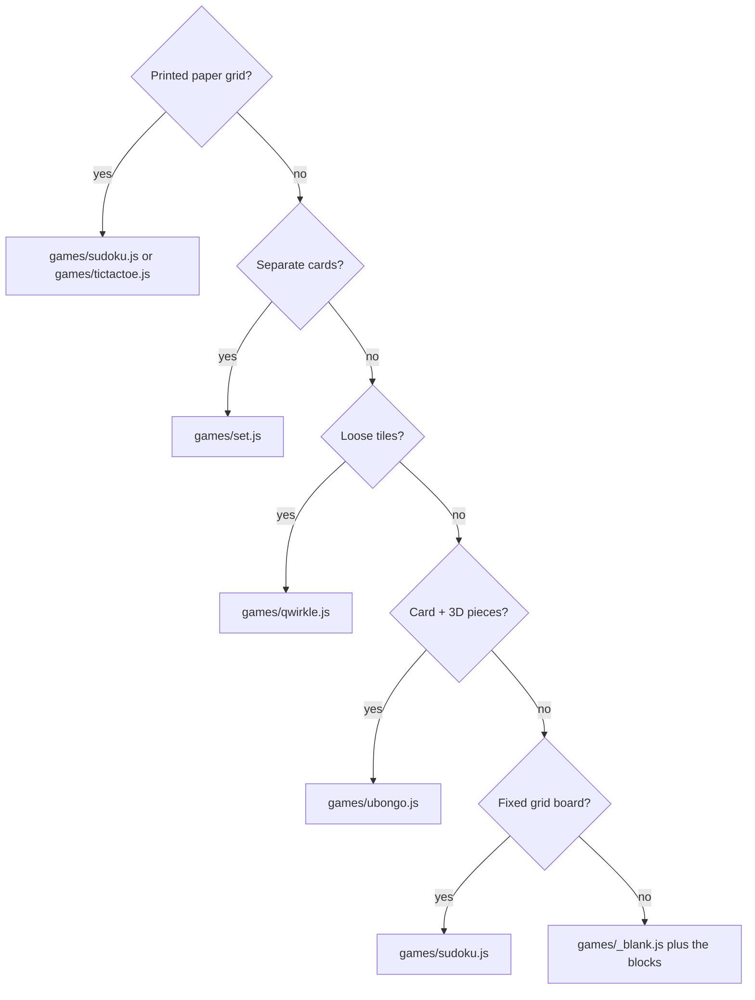

# Which game fits? (for participants picking a game, and the facilitator)

## A game fits when

- [ ] It lies **flat** on a table (no towers, no pieces hiding others).
- [ ] It has **clear fields or cards**: a grid, separate cards, or tiles in rows.
- [ ] Pieces differ by **colour or simple shape**, with **good contrast** to the table and board.
- [ ] The state fits in a small JSON (a grid of names, a list of cards).
- [ ] The rules for "a good next move" fit in a page of code.

Harder: tiny pieces, shiny surfaces, tall pieces seen from the side, hidden information (hands of cards),
many piece types that look alike.

Now possible with the building blocks ([engine/README.md](../engine/README.md)): **3D pieces** lying on the table
(`pieces3d` names them, `iso` draws them in 3D, `cover` fills a shape with them, as in Ubongo), small printed
pictures on cards (`pictures`), and a die roll you tap in yourself.

## Which starter to copy

Answer the questions top to bottom; the table below the diagram explains each one with example games.

| Your game looks like | Copy | Why |
| --- | --- | --- |
| Paper grid, written marks (Sudoku, Tic-Tac-Toe, Battleship, Dots and Boxes) | `games/sudoku.js` or `games/tictactoe.js` | Print a sheet with a black frame from `print.html`; finding the board is done. |
| Separate cards on the table (Set, card games) | `games/set.js` | Finds many cards at once and straightens each. |
| Tiles in a free grid (Qwirkle, Scrabble, dominoes) | `games/qwirkle.js` | Finds loose tiles, their row and column, and their colour. |
| Puzzle card plus 3D pieces (Ubongo, Katamino, Blokus) | `games/ubongo.js` | Reads the card, the roll and the pieces and draws the answer; the solver is your task (the `cover` block helps). |
| Board with a fixed grid (chess, checkers, Connect Four, Go) | `games/sudoku.js` | Same steps: find board, cut into cells, name each cell. |
| Your own game, built from blocks | `games/_blank.js` plus the blocks | Pick the blocks in [engine/README.md](../engine/README.md) (cards, fields, color, pieces3d, cover, …) and glue them in `detect()`. Look at the starter that is closest. |
| Something else, from scratch | `games/_blank.js` | The empty template with the contract explained. |

Then add the name to `games/list.js` and open the page with `#<your-game>`.
How the pieces fit together: [architecture](../docs/ARCHITECTURE.md). See also the [intro slides](slides.html) (slide 26: three ways in), the [facilitator guide](facilitator.md) and the [README](../README.md).
