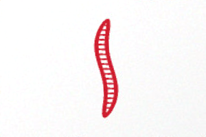
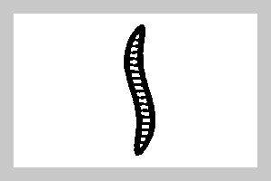
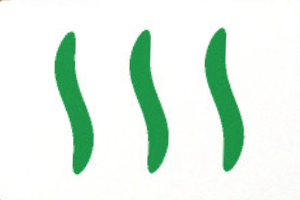
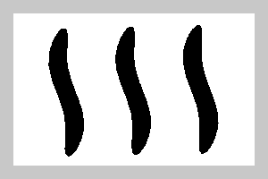

# Track 2: build more (Set)

You build the card reader and the solver of [`games/set.js`](../../games/set.js) in seven small steps: read a
card's colour, its symbols, their shape and fill, then find every set and keep the labels steady on live video.
The page already finds the cards, straightens each one and fixes the light (white balance). This lesson explains
the computer-vision side. It does not explain JavaScript.

**Time:** 63–115 min for all seven steps; the build slot is 90 min. Every step is **10–20 min at most** and ends
with a green checker line, so you can stop after any step and still have a working result. Short on time: do
TODO 5 and 6 (plain logic) right after TODO 1, then come back to the vision steps. The ranges are **first
estimates**; see [How the times were set](#how-the-times-were-set).

**Photos:** the checker uses the two drawn photos (`six-cards.jpg`, `twelve-cards.jpg`) and the 4 real photos on
the dark table (`replay/set/owner/`). A photo where the starter's card finder misses cards is named and not
counted. The white-desk photos (`owner-white/`) are left out: there the cards are found from their symbols, a
step beyond this track (see `symbolCards` in `solutions/set.js` if you are curious).

| Step | What | Beginner range | Stuck after → open hint 1 |
| --- | --- | --- | --- |
| 0 | Set up, see the input | 3–5 min | 5 min |
| 1 | TODO 1: colour | 10–15 min | 8 min |
| 2 | TODO 2: symbols (number) | 10–20 min | 10 min |
| 3 | TODO 3: shape | 10–20 min | 10 min |
| 4 | TODO 4: fill | 10–20 min | 10 min |
| 5 | TODO 5: is it a set? | 5–10 min | 5 min |
| 6 | TODO 6: every set | 5–10 min | 5 min |
| 7 | TODO 7: steady labels | 10–15 min | 8 min |

## The rules of Set

Every card has four features with three values each: **colour** (red, green, purple), **number** (1, 2, 3
symbols), **shape** (diamond, oval, squiggle) and **fill** (solid, striped, empty). Three cards are a **set** when
each feature is either the same on all three or different on all three. 1 red solid diamond, 2 green striped
ovals, 3 purple empty squiggles: a set. 1, 2 and 3 red solid ovals: a set. Two ovals and a diamond: not a set.

## Step 0: set up and look at the input

1. `pnpm install` once, then start the checker in a second terminal and leave it running:

   ```sh
   pnpm learn set --watch
   ```

   It runs your `detect()` on the photos and your `isSet`, `solve` and `steady` on fixed cases, on every save.
   Right now it prints seven red lines, for example:

   ```text
   TODO 1: 0/18 colours ✗
     six-cards.jpg card 1: read null, expected "red"
     ...
     deck-b-wide.jpg: 8 of 12 cards found, not counted (finding cards is done code, #124)
     ...
     deck-b-turned.jpg: 15 of 12 cards found, not counted (finding cards is done code, #124)
   ...
   TODO 5: 1099/1125 triples ✗
   TODO 6: 4/10 boards ✗
   TODO 7: 1/3 frame rows ✗
     one wrong read after 9 good ones: shows color "green", expected "red"
   ```

   Cards are numbered in reading order: rows top to bottom, left to right. On the 4 real photos the starter's
   simple card finder (done code, `engine.findCards`) finds 8 to 16 of the 12 cards, so those photos are named but
   not counted for TODO 1–4. That is not your bug. TODO 5 and 6 still use all 6 photos: they get the true cards
   from the photos' truth files.
2. See what your code gets: open the page with `#set&replay` (sample photos, no camera), tap **Steps** in the
   bottom bar. The tile **card** is the first card as your functions get it: straightened, white-balanced. In
   the Steps view every card also shows its label (`? ? ? ?` until you fill the TODOs).

**Done when:** the checker prints its seven lines and you have seen the straightened card in Steps.

## From photo to card image

`detect(frame)` gets the camera picture as a `Frame`: `{ width, height, data }`, `data` a flat RGBA byte array,
pixel `(x, y)` at index `(y * width + x) * 4`. The done code then:

1. **finds the cards** (`engine.findCards`: bright four-sided shapes) and puts them in reading order;
2. **straightens** each one with a perspective warp (a homography) to 300 × 200 px, lying on its long side, so the
   symbols stand upright side by side;
3. **white-balances** it: every channel is divided by the paper's colour. Evening light makes paper orange; after
   this the paper is white again and a green symbol is green, not olive. Without it, thresholds that work on one
   photo fail on the next.

`isInk(image, x, y)` (done) tells ink from paper for one pixel: dark, or strongly coloured. A 15 px border
(`EDGE`) never counts: rounded corners and table. These are two cards as your functions get them, and their ink:

 

 

<a id="todo-1"></a>

## TODO 1: colour (10–15 min)

**Goal:** `readColor(image, engine)` returns `'red'`, `'green'` or `'purple'` (`null` if unsure).

**You get:** one straightened, white-balanced card (300 × 200 px) and the engine.

**Checker when done:** `TODO 1: 18/18 colours ✓`

<details><summary>Hint 1: the concept</summary>

Most of the card is paper; the colour you want is the most common colour that is **not** paper. Colour names come
from hue (the angle on the colour wheel), which stays about the same when the light gets darker. Building blocks:
`engine.cropTiles` (cut out a rectangle) and `engine.dominantColor(tile, { ignore })` in
[engine/README.md](../../engine/README.md).
</details>

<details><summary>Hint 2: the approach</summary>

Crop the card inside the `EDGE` border, call `dominantColor` with `ignore: ['white', 'gray', 'black']`, then map
its name to Set's three colours: red, pink, orange → `'red'`; green, cyan, yellow → `'green'`; purple, blue →
`'purple'`. Real light pushes colours across names (a red under warm light reads orange), hence the groups.
</details>

<details><summary>Answer</summary>

```js
const inner = engine.cropTiles(image, [{ x: EDGE, y: EDGE, width: CARD_WIDTH - 2 * EDGE, height: CARD_HEIGHT - 2 * EDGE }])[0];
const main = engine.dominantColor(inner, { ignore: ['white', 'gray', 'black'] });
if (!main) return null;
if (['red', 'pink', 'orange'].includes(main.name)) return 'red';
if (['green', 'cyan', 'yellow'].includes(main.name)) return 'green';
if (['purple', 'blue'].includes(main.name)) return 'purple';
return null;
```
</details>

<a id="todo-2"></a>

## TODO 2: symbols, the number (10–20 min)

**Goal:** `findSymbols(image)` returns one box `{ x0, x1, y0, y1 }` per symbol, left to right (inclusive pixel
bounds). The done code counts them: 1–3 boxes give the number, anything else gives `null`. TODO 3 and 4 get the
first box.

**Checker when done:** `TODO 2: 18/18 numbers ✓`

<details><summary>Hint 1: the concept</summary>

This is **segmentation**: split the picture into objects. The general tool is connected components or contours
(OpenCV `findContours`, as `solutions/set.js` does). Here a cheaper trick works because the symbols stand side by
side with paper between them: a **projection**. Count the ink per column; symbols are runs of inky columns.
</details>

<details><summary>Hint 2: the approach</summary>

For each column `x` from `EDGE` to `width - EDGE`, count ink pixels (rows `EDGE` to `height - EDGE`). A column
with 3 or more is inky. Each run of inky columns at least 5 px wide is a symbol (narrower: noise, a speck). For
each run, the box's `y0` / `y1` are the first and last rows with 2 or more ink pixels between `x0` and `x1`.
Why thresholds of "3" and "5" and not "1": real photos have specks of dust and paper texture.
</details>

<details><summary>Answer</summary>

```js
export function findSymbols(image) {
  const inkIn = (x) => { let n = 0; for (let y = EDGE; y < image.height - EDGE; y++) if (isInk(image, x, y)) n++; return n; };
  const boxes = [];
  let start = -1;
  for (let x = EDGE; x <= image.width - EDGE; x++) {
    const ink = x < image.width - EDGE && inkIn(x) >= 3;
    if (ink && start < 0) start = x;
    if (!ink && start >= 0) {
      if (x - start >= 5) boxes.push(rowsOf(image, start, x - 1));
      start = -1;
    }
  }
  return boxes;
}

function rowsOf(image, x0, x1) {
  let y0 = -1, y1 = -1;
  for (let y = EDGE; y < image.height - EDGE; y++) {
    let n = 0;
    for (let x = x0; x <= x1; x++) if (isInk(image, x, y)) n++;
    if (n >= 2) { if (y0 < 0) y0 = y; y1 = y; }
  }
  return { x0, x1, y0, y1 };
}
```
</details>

<a id="todo-3"></a>

## TODO 3: shape (10–20 min)

**Goal:** `readShape(image, box)` returns `'diamond'`, `'oval'` or `'squiggle'` for the symbol in `box`.

**Checker when done:** `TODO 3: 18/18 shapes ✓`

<details><summary>Hint 1: the concept</summary>

Classify by **shape descriptors**: numbers that do not depend on size, then thresholds. Two work here: how much of
its box the outline fills (diamond about half, oval more), and whether the symbol bends (squiggle). Fill the
outline row by row first (leftmost to rightmost ink), so striped and empty symbols count like solid ones.
`solutions/set.js` uses OpenCV's equivalents: box fill and solidity (area against the convex hull).
</details>

<details><summary>Hint 2: the approach</summary>

For every row of the box take the leftmost and rightmost ink pixel. Add up `right - left + 1` and divide by the
box area: the **box fill**. In the middle half of the rows, track the middle point `(left + right) / 2`; if it moves
sideways by more than about 0.15 of the box width, it is a `'squiggle'`. Otherwise box fill below about 0.65 →
`'diamond'`, above about 0.9 → `'diamond'` too (some decks print a rectangle, box fill about 0.95), else `'oval'`
(about 0.75–0.85). Measured on the photos: drawn diamonds 0.52–0.53, ovals 0.83–0.86, squiggles bend 0.35–0.48;
the real deck's squiggles bend only about 0.16, which is why the limit is 0.15 and not 0.25.
</details>

<details><summary>Answer</summary>

```js
function readShape(image, box) {
  const h = box.y1 - box.y0 + 1, w = box.x1 - box.x0 + 1;
  let filled = 0;
  const mids = [];
  for (let y = box.y0; y <= box.y1; y++) {
    let l = -1, r = -1;
    for (let x = box.x0; x <= box.x1; x++) if (isInk(image, x, y)) { if (l < 0) l = x; r = x; }
    if (l < 0) continue;
    filled += r - l + 1;
    if (y > box.y0 + h / 4 && y < box.y1 - h / 4) mids.push((l + r) / 2);
  }
  const fill = filled / (w * h);
  if (Math.max(...mids) - Math.min(...mids) > 0.15 * w) return 'squiggle';
  return fill < 0.65 || fill > 0.9 ? 'diamond' : 'oval';
}
```
</details>

<a id="todo-4"></a>

## TODO 4: fill (10–20 min)

**Goal:** `readFill(image, box)` returns `'solid'`, `'striped'` or `'empty'` for the symbol in `box`.

**Checker when done:** `TODO 4: 18/18 fills ✓`

<details><summary>Hint 1: the concept</summary>

Measure the **ink share inside** the symbol, away from its outline: solid is almost all ink, empty almost none,
striped in between (thin lines with paper between them). Look at the ink pictures above: the outline is ink for
all three fills, so it must not count.
</details>

<details><summary>Hint 2: the approach</summary>

Take the rows in the middle half of the box. In each, take the pixels from the leftmost to the rightmost ink pixel,
minus a quarter of that width at each end (the outline). Ink share there: above 0.75 → `'solid'`, below 0.2 →
`'empty'`, else `'striped'`. Measured: solid 1.0, striped 0.42–0.58, empty 0–0.19. Why it breaks in real light:
faint stripes on a real card measure only about 0.14 (it reads "empty"); the solution's way is a paper threshold
per card (Otsu's method) and the size of the paper hole inside the symbol.
</details>

<details><summary>Answer</summary>

```js
function readFill(image, box) {
  const h = box.y1 - box.y0 + 1;
  let ink = 0, all = 0;
  for (let y = Math.round(box.y0 + h / 4); y <= box.y1 - h / 4; y++) {
    let l = -1, r = -1;
    for (let x = box.x0; x <= box.x1; x++) if (isInk(image, x, y)) { if (l < 0) l = x; r = x; }
    if (l < 0) continue;
    const q = (r - l) / 4;
    for (let x = Math.round(l + q); x <= r - q; x++) { all++; if (isInk(image, x, y)) ink++; }
  }
  const share = ink / Math.max(1, all);
  return share > 0.75 ? 'solid' : share < 0.2 ? 'empty' : 'striped';
}
```
</details>

**Try it live:** lay out 12 Set cards on a dark table, open `#set` on the phone. With TODO 1–4 green every card
gets a label (tap a card, or open Steps).

<a id="todo-5"></a>

## TODO 5: is it a set? (5–10 min)

**Goal:** `isSet(a, b, c)` returns `true` when the three cards are a set (see the rules above), else `false`.
A card with a `null` feature (not read) is never part of a set.

**Checker when done:** `TODO 5: 1125/1125 triples ✓` (5 fixed triples plus every triple of the 6 photos' truth
files). This is where a probabilistic read meets a deterministic rule: one misread feature turns a set into a
non-set, so the rule must not guess on `null`.

<details><summary>Hint 1: the concept</summary>

"All the same or all different" for three values means: the number of distinct values is 1 or 3, never 2.
</details>

<details><summary>Hint 2: the approach</summary>

`FEATURES.every((f) => …)` with `new Set([a[f], b[f], c[f]]).size !== 2`, and a `null` check first.
</details>

Answer: `isSet` in `solutions/set.js` (on the `solutions` branch, or
[online](https://github.com/JannisTriesToCode/board-vision/blob/main/solutions/set.js)).

<a id="todo-6"></a>

## TODO 6: every set (5–10 min)

**Goal:** `solve(state)` returns `{ sets: [[i, j, k], …] }`, every set as positions in `state.cards` (any order),
or `null` when there is none. The page outlines the first set in yellow.

**Checker when done:** `TODO 6: 10/10 boards ✓` (4 fixed boards plus the 6 photos' truth files; `six-cards.jpg`
has no set, `twelve-cards.jpg` 6, each real photo 4 or 5).

<details><summary>Hint 1: the concept</summary>

12 cards have only 220 triples: try them all. No clever search needed.
</details>

<details><summary>Hint 2: the approach</summary>

Three loops `i < j < k`, keep each triple where `isSet` is true. (A faster way exists: for any two cards the third
card of their set is fixed, so look it up in a map. Not needed for 12–15 cards.)
</details>

Answer: `solve` in `solutions/set.js` (on the `solutions` branch, or
[online](https://github.com/JannisTriesToCode/board-vision/blob/main/solutions/set.js)).

<a id="todo-7"></a>

## TODO 7: steady labels (10–15 min)

**Goal:** `steady(state)` returns the state with each card's features smoothed over the last frames: a
feature shows the value most recent frames agree on, or `null` when they do not agree. The page calls it on
live video only, once per detect.

**Checker when done:** `TODO 7: 3/3 frame rows ✓` (a read that stays the same; one wrong read after 9 good
ones must not show; red and green taking turns must show `null`).

<details><summary>Hint 1: the concept</summary>

A single frame's read is **noisy**: blur, glare, a hand. Instead of trusting one frame, **vote** over a window of
frames. To vote per card you must know which card in this frame is which card in the last one: **tracking**,
here simply the nearest card middle. Building block: `createVotes` in
[engine/steady.js](../../engine/steady.js).
</details>

<details><summary>Hint 2: the approach</summary>

Once, outside the function: `const votes = createVotes({ features: FEATURES });` (import it from
`'../engine/steady.js'`; default: 10 frames, 60 % must agree). In `steady`:
`return { ...state, cards: votes.update(state.cards) };`. To write it yourself instead: keep a list of tracks
`{ middle, history }`, pair each card with the nearest track, push its features, keep the last 10.
</details>

Answer: `steady` in `solutions/set.js` (on the `solutions` branch, or
[online](https://github.com/JannisTriesToCode/board-vision/blob/main/solutions/set.js)).

## Prompts for your AI tool

The lesson is about understanding the vision part, so use your AI tool as a reviewer and measuring aid, not as
the author. Copy one (copy button on each block):

```text
I am doing TODO 3 (shape) in games/set.js myself. Write a throwaway script that prints, for every card
on six-cards.jpg and twelve-cards.jpg in replay/set, the measurement I describe below, grouped by the
shape in the .truth.json file. Do not touch games/set.js. Measurement: <your idea>
```

```text
Review my TODO 1-4 in games/set.js: which thresholds did I choose, what is the margin to the nearest
wrong card on the checked photos, and what would break them on a phone (warm light, blur, glare)?
Check with pnpm learn set and show its output.
```

```text
Before I write TODO 5 and 6 in games/set.js, write unit tests for isSet() and solve(): a set with every
feature different, two-and-one (no set), a card with a null feature, a board without a set (null). Do not
implement them. Run pnpm learn set and show which lines are red.
```

## Finished?

`pnpm learn set` prints seven green lines. Open `#set` on the phone and play a round against the suggestion.
More: the [mini tasks](../tasks.md), or compare your reader with `solutions/set.js` (OpenCV contours, Otsu
threshold) on the harder photos: `node replay/run.js set/owner`.

## How the times were set

- Ranges are for a developer who knows JavaScript but has no computer-vision background. Rule: plain logic ≈
  1.5–2× an experienced developer's hands-on time, CV and tuning ≈ 3× (unfamiliar domain), rounded up to 5 min.
- Hands-on time of an experienced developer, estimated (not yet measured): setup 2 min; colour 4 min, symbols
  6 min, shape 6 min, fill 5 min (CV, × 3); isSet 2 min, every set 4 min (logic, × 2); steady 5 min with the
  engine block (an unfamiliar idea, × 2–3). → the ranges in the table.
- All seven at the top of their ranges: 115 min, more than the 90 min build. That is on purpose: the steps are
  stackable, each ends green, and most people will stop after TODO 4 or 6.
- Photos: the 2 drawn photos and the 4 dark-table owner photos (issue #124). The ranges are still estimates; a
  dry run with `--times` is the way to correct them.
- `pnpm learn set --times` prints, per TODO, the minutes from your first checker run until it first went green.
  The times stay on your computer (`.learn-times.json`); nothing is uploaded. Facilitators: collect them by hand
  after a dry run and adjust the ranges here.
