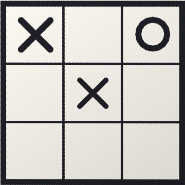
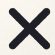
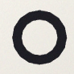

# Track 1: fill the gaps (Tic-Tac-Toe)

You finish two TODOs in [`games/tictactoe.js`](../../games/tictactoe.js): read X or O from a picture, then pick
the best move. The page already finds the sheet, straightens it and cuts it into cells; you write the parts in
between. This lesson explains the computer-vision side. It does not explain JavaScript.

**Time:** 23–40 min for the whole track (the budget is 45 min). The ranges below are **first estimates**; see
[How the times were set](#how-the-times-were-set).

| Step | What | Beginner range | Stuck after → open hint 1 |
| --- | --- | --- | --- |
| 0 | Set up, see the input | 3–5 min | 5 min |
| 1 | TODO 1: X or O | 10–20 min | 10 min |
| 2 | TODO 2: best move | 10–15 min | 8 min |

## Step 0: set up and look at the input

1. `pnpm install` once, then start the checker in a second terminal and leave it running:

   ```sh
   pnpm learn tictactoe --watch
   ```

   It runs your `detect()` on the photos in [`replay/tictactoe/`](../../replay/tictactoe/) and your `solve()` on
   fixed positions, on every save. Right now it prints:

   ```text
   TODO 1: 11/18 cells ✗
     o-to-move.jpg row 1 col 1: read null, expected "X"
     ...
   TODO 2: 3/9 positions ✗
     empty board: expected a move for X, got null
     ...
   ```

   The 11 green cells are the empty ones: telling empty from written is already done.
2. See what your code gets: open the page with `#tictactoe&replay` (the replay photos, no camera needed), tap
   **Steps** in the bottom bar. Each tile is one stage: the camera picture, the found board, the straightened board. The last
   tile, **Knobs**, has sliders for the thresholds; turn them and watch what changes.

**Done when:** the checker prints its two lines and you have seen the straightened board in Steps.

## A picture is an array of numbers

`detect(frame)` gets a `Frame`: `{ width, height, data }`, where `data` is a flat `Uint8ClampedArray` of
`width × height × 4` bytes, row by row, each pixel as red, green, blue, alpha (0–255). The pixel at `(x, y)`
starts at index `(y * width + x) * 4`. That is all a camera gives you; everything else is arithmetic on it.

The page turns the photo into this straightened board (360 × 360 px), then cuts it into 9 cells, 10 % trimmed off
each side so the grid lines do not count:



<a id="todo-1"></a>

## TODO 1: X or O (10–20 min)

**Goal:** `readMark(cell, paper)` returns `'X'` or `'O'` for a cell that has ink in it (`null` if unsure).

**You get:** `cell`, one cut cell as a `Frame` (about 92 × 92 px), and `paper`, the average brightness of the
board (0 = black, 255 = white). `isInk(cell, x, y, paper)` already tells you whether one pixel is ink (clearly
darker than the paper). Empty cells never reach `readMark`. These are two cells it gets:

 

**Checker when done:** `TODO 1: 18/18 cells ✓`

<details><summary>Hint 1: the concept</summary>

Do not try to recognise the shape as a whole. Find one **feature** that is different for the two classes and
measure it with a threshold. Compare the two cells above: where is there ink in one and paper in the other? The
building block is plain pixel counting with `isInk`; no OpenCV needed. (The other way, few-shot with an
embedder, is `engine.classify` in [engine/README.md](../../engine/README.md); overkill here.)
</details>

<details><summary>Hint 2: the approach</summary>

An X crosses in the middle of the cell, an O has a hole there. Take a small square in the middle (about a fifth
of the cell's width), count its ink pixels with `isInk`, and divide by the square's area. More than about 0.2 →
`'X'`, else `'O'`. Why a share and not a count: cells are not always the same size in pixels. Why it can break in
real light: a shadow over the hole looks like ink; `paper` is measured per board, which helps.
</details>

Answer: `readMark` in `solutions/tictactoe.js` (on the `solutions` branch of your workshop repo, or
[online](https://github.com/JannisTriesToCode/board-vision/blob/main/solutions/tictactoe.js)).

**Try it live:** print page 2 of [print.html](../../print.html), open `#tictactoe` on the phone, and draw.

<a id="todo-2"></a>

## TODO 2: best move (10–15 min)

**Goal:** `solve(state)` returns `{ row, col, player }`, the best move for the player to move, or `null` when
the game is over (someone has three in a line, or the board is full) or a cell is `null` (not read yet).

**You get:** `state.cells`, 3 rows of 3 cells: `'X'`, `'O'`, `''` (empty) or `null`. X starts, so equal counts
mean X is to move. `solve` is pure: no engine, no picture. This is the step where a probabilistic read
(TODO 1) meets deterministic rules: the solver must not trust a half-read board, hence the `null` cases.

**Checker when done:** `TODO 2: 9/9 positions ✓` (7 fixed positions plus the two photos). A move passes when it
is as good as the best one (win, else draw), so more than one answer can be right.

<details><summary>Hint 1: the concept</summary>

There are 8 lines (3 rows, 3 columns, 2 diagonals). Write `winner(cells)` first; you need it for "game over"
and for choosing a move. Then search the game tree: with at most 9 empty cells, trying every line of play is cheap.
</details>

<details><summary>Hint 2: the approach</summary>

Use **minimax**: try every empty cell, score it +1 if you win in the end, 0 for a draw, −1 if you lose, assuming
the other player then plays their best (the same function, called for them, negated). 9! positions at most: no
pruning needed. A rule list (win now, block, middle, corner, any) is not enough: on `x-to-move.jpg` X has a
**fork** (two threats at once) that wins, and a plain corner rule only draws; the checker says so.
</details>

Answer: `solve`, `winner` and `minimax` in `solutions/tictactoe.js` (on the `solutions` branch, or
[online](https://github.com/JannisTriesToCode/board-vision/blob/main/solutions/tictactoe.js)).

## Prompts for your AI tool

The lesson is about understanding the vision part, so use your AI tool as a reviewer and measuring aid, not as
the author. Copy one (copy button on each block):

```text
I am doing TODO 1 in games/tictactoe.js myself. Write a throwaway script that prints, for every cell in
the replay/tictactoe photos, the ink feature I describe below, grouped by the truth (X, O, empty). Do
not touch games/tictactoe.js. Feature: <your idea>
```

```text
Review my TODO 1 in games/tictactoe.js: which threshold did I choose, what is the margin to the nearest
wrong cell on the replay photos, and what would break it on a phone (blur, shadow, thin pen)? Check with
pnpm learn tictactoe and show its output.
```

```text
Before I write TODO 2 (best move), write unit tests for games/tictactoe.js solve(): a forced win, a
forced block, a full board (null). Do not implement solve(). Run pnpm learn tictactoe and show which
lines are red.
```

## Finished?

`pnpm learn tictactoe` prints two green lines. Open `#tictactoe` on the phone and play a real game against the
suggestion. Next: [Track 2, Set](set.md), or the
[mini tasks](../tasks.md).

## How the times were set

- Ranges are for a developer who knows JavaScript but has no computer-vision background. Rule: plain logic ≈
  1.5–2× an experienced developer's hands-on time, CV and tuning ≈ 3× (unfamiliar domain), rounded up to 5 min.
- Hands-on time of an experienced developer, estimated (not yet measured): setup 2 min, TODO 1 about 5–7 min,
  TODO 2 about 7 min with minimax. → 3–5, 10–20 (3×), 10–15 (1.5–2×) min.
- Top of all ranges: 40 min, so the 45 min slot keeps about 10 % free. Workshop pilots usually run longer
  than planned; these numbers get corrected after a dry run.
- `pnpm learn tictactoe --times` prints, per TODO, the minutes from your first checker run until it first went
  green. The times stay on your computer (`.learn-times.json`); nothing is uploaded. Facilitators: collect them
  by hand after a dry run and adjust the ranges here.
